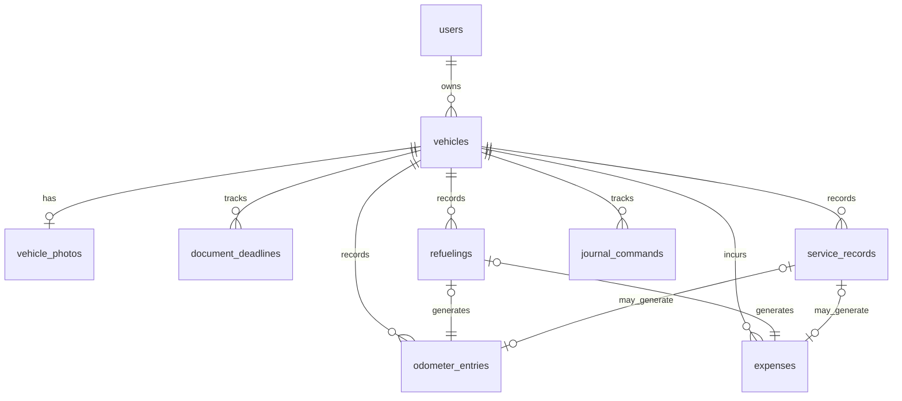

# Architektura i baza danych

Android korzysta z Kotlin i Jetpack Compose. ViewModele udostępniają stan przez StateFlow. Repozytoria wywołują REST API przez Retrofit, a odczytane dane mogą pozostać w pamięci przy przełączaniu ekranów. Część ustawień, sesja i dane potrzebne do przypomnień są przechowywane na urządzeniu. WorkManager obsługuje sprawdzanie terminów w tle.

Backend używa Java 21, Spring Boot, Spring Security oraz PostgreSQL. JPA obsługuje operacje zapisu, a zapytania SQL obliczają statystyki i łączą wpisy dziennika. API sprawdza właściciela pojazdu przed zwróceniem jego danych. Flyway tworzy i aktualizuje bazę, a Hibernate weryfikuje schemat przy starcie.

| Dane | Tabele i powiązania |
| --- | --- |
| Konta i garaż | `users` → `vehicles`. Każdy pojazd należy do jednego konta. |
| Zdjęcie pojazdu | `vehicles.photo_version` oraz `vehicle_photos`. Jeden opcjonalny JPEG na pojazd. Usunięcie pojazdu usuwa zdjęcie. |
| Pomiary i wydatki | `odometer_entries` i `expenses` są przypisane do pojazdu. Tankowanie zapisuje własny wpis, powiązany pomiar i powiązany wydatek. |
| Serwis | `service_records` może mieć powiązany wydatek, pomiar i kolejny termin. |
| Dokumenty | `document_deadlines` przechowuje typ, termin ważności i notatkę. |

Wydatki za tankowanie i płatny serwis są ujęte w sumie raz. Widok przeglądu sumuje wydatki w dokładnym zakresie dat włącznie. Wykres pokazuje koszty według miesięcy kalendarzowych, a dotknięcie słupka otwiera podsumowanie całego miesiąca. Diagram kategorii w **Szczegóły** używa zakresu wskazanego przy głównej kwocie.

Migracje wydania obejmują V1–V5. [Schemat SQL](schema.sql) pochodzi z lokalnej bazy po zastosowaniu migracji. Źródło migracji znajduje się w `backend/src/main/resources/db/migration`.

